# Daily Pulse: Design Document

Status: **Draft / design only**. Nothing gets built until John says go.

## 1. Goal
A personal news pulse, just for John, in the spirit of Robert Scoble's [News Pulse](https://news-pulse-docs-4g7j.pages.grok.bot/). It's a long list of very short, linked bullets on topics he wants to follow up on. It's published as a **Grok Bot Page** and auto-refreshed daily at **5:00 AM PT** by a Grok Bot routine.

## 2. Look & feel (Hacker News style)
- **Mobile-first** (~90% of reading is on a phone). It's a dense numbered list in Hacker News style, but the type stays readable and the tap targets are comfortable: about 44px tall rows, full-width links, and no tiny hit areas.
- Bullets are kept short so most fit on one or two lines on a phone.
- Bullets are **headlines only**, with no summaries or hover "why it matters" text. **The bullet text is a link to its own source** (X post or article) and opens in a new tab (`target="_blank" rel="noopener"`).
- A small gray source domain follows each headline, e.g. `(x.com)` or `(ocregister.com)`.
- A thin header shows the date, the refresh timestamp, and ← previous / next → links.
- The footer credits Robert Scoble / Scobleizer for the feeds.

```
Daily Pulse · Mon Nov 2, 2026 · refreshed 5:00 AM PT   ← prev | index
TOP STORIES
 1. Headline text goes here (x.com)
 2. Another headline (reuters.com)
AI
 1. ...
```

## 3. Topics (defaults, all configurable)
| Order | Topic | Bullets |
|---|---|---|
| 1 | Top Stories | 10 |
| 2 | AI | 10 |
| 3 | Investing & Markets | 10 |
| 4 | General Tech | 10 |
| 5 | Huntington Beach / OC Local | 3 |

Topics, order, per-topic counts, sources, and search terms all live in `config.yaml`. We expect to iterate a lot, so changes shouldn't require code edits.

```yaml
timezone: America/Los_Angeles
schedule: "0 5 * * *"
topics:
  - id: top
    title: Top Stories
    count: 10
    feeds: [https://presto-ferry-g7bz.here.now/feeds/top-20.xml]
    x_search: []
  - id: ai
    title: AI
    count: 10
    feeds: [<scoble ai feed>]
    x_search: ["AI model release", "OpenAI OR Anthropic OR xAI"]
  - id: markets
    title: Investing & Markets
    count: 10
    feeds: [<scoble investor feed>]
  - id: tech
    title: General Tech
    count: 10
    feeds: [<scoble tech feed>]
  - id: hb
    title: Huntington Beach / OC Local
    count: 3
    feeds: [<OC Register>, <Voice of OC>, <City of HB news>, https://www.reddit.com/r/huntingtonbeach/.rss]
    use_x: false
```

## 4. Sources
- **Scoble's RSS feeds**: `https://presto-ferry-g7bz.here.now/feeds/top-20.xml`, plus the sibling per-topic feeds, OPML, and `index.json`. Items mostly link to x.com and include a title, summary, "why it matters," and a category.
- **Own X searches** via Grok Bot public X reads (limits: 30 calls/min, 1,000/day, 25 results/call). These fill gaps and serve as the fallback when a feed is stale.
- **Local news** comes from OC news sites (OC Register, Voice of OC, City of Huntington Beach feeds) plus **Reddit r/huntingtonbeach**, not from X.
- *Future / back burner:* Discord local communities.

## 5. Pipeline

```mermaid
flowchart LR
  A[Routine 5 AM PT] --> B[Load config.yaml]
  B --> C[Fetch Scoble RSS feeds]
  B --> D[Fetch OC local feeds]
  C --> E{Feed fresh?}
  E -- no --> F[Own X searches]
  E -- yes --> G[Items from last 24h]
  F --> G
  D --> G
  G --> H[Dedupe by normalized URL, incl. prior runs]
  H --> I[Rank by engagement / recency]
  I --> J{N items?}
  J -- short --> F2[Fill gaps with X searches] --> K
  J -- yes --> K[Take N per topic]
  K --> L[Render HN-style HTML]
  L --> M[Save snapshot YYYY-MM-DD_HHMM]
  M --> N[Update prev/next links + index]
  N --> O[Publish Grok Bot Page]
  O --> P[git commit + push snapshot]
```


## 6. Snapshots & history
- Each run writes its own file, named by date and time, e.g. `runs/2026-11-02_0500.html`.
- Each page links ← previous / next →.
- An `index` page lists all runs, newest first.
- **Snapshots are kept forever**, with no pruning.
- **Every run's snapshot is committed to this repo** (along with the updated index and `state/seen.json`) and pushed.

## 6a. Dedupe rule
- Dedupe by **exact article / URL only**. The same story or topic may come back in later runs (say, a different outlet's article), but the exact same article never appears twice. That holds within a run and across all prior runs.
- URLs are normalized before comparing: lowercase the scheme and host, strip `www.` and `m.`, drop tracking params (`utm_*`, `fbclid`, `gclid`, `ref`, `s`, `t` on x.com), drop fragments and trailing slashes, and collapse `twitter.com`/`mobile.twitter.com` to `x.com`. X posts are keyed by status ID.
- `state/seen.json` stores the normalized URLs of every published item.

## 6b. Ranking (engagement)
- **X posts:** a weighted score from public metrics (likes, reposts, replies, views), normalized by recency (age decay), so a fresh post with strong traction beats an old viral one.
- **Web articles:** ranked by the engagement of the X posts and Reddit threads sharing them. For r/huntingtonbeach that means Reddit score and comment count.
- **No signals:** items fall back to recency.
- Weights live in `config.yaml` and can be overridden per topic:

```yaml
ranking:
  x:      {likes: 1.0, reposts: 2.0, replies: 1.5, views: 0.01}
  reddit: {score: 1.0, comments: 2.0}
  recency_half_life_hours: 12
  fallback: recency
```

## 7. Refresh button: deferred (not in v1)
v1 refreshes only on the daily 5 AM PT routine, or when John asks in chat. A later version may add an on-page button. Whether a Page can trigger a run directly is still unverified.

## 8. Proposed repo layout
```
daily-pulse/
  README.md
  DESIGN.md
  config.yaml          # topics, counts, sources, search terms
  src/
    fetch.py           # RSS + local feeds
    xsearch.py         # X search gap-fill/fallback
    rank.py            # dedupe, seen-filter, ranking
    render.py          # HN-style HTML
    publish.py         # snapshot, prev/next, index, Page publish
  templates/page.html
  runs/                # one snapshot per run
  state/seen.json
```

## 9. Decisions (resolved)
- Headlines only, with no hover summaries. Mobile-first dense layout.
- Snapshots kept forever, and each run is committed to the repo.
- Local sources are OC news sites plus r/huntingtonbeach. Discord is a future idea.
- Dedupe by exact normalized URL only, and topics may recur.
- Refresh button deferred past v1.
- Ranking is by engagement (see section 6b).

## 10. Open questions
1. Exact URLs for Scoble's AI, Tech, and Investor feeds (read from the OPML / index.json), and the local feed URLs.
2. Which City of HB feeds are reliable, and is Reddit's RSS reachable from the routine?
