# Daily Pulse: Design Document

Status: **Draft / design only**. Nothing gets built until John says go.

## 1. Goal
A personal news pulse, just for John, in the spirit of Robert Scoble's [News Pulse](https://news-pulse-docs-4g7j.pages.grok.bot/). It's a long list of very short, linked bullets on topics he wants to follow up on. It's published as a **Grok Bot Page** and auto-refreshed daily at **5:00 AM PT** by a Grok Bot routine.

## 2. Look & feel (Hacker News style)
- **Mobile-first** (~90% of reading is on a phone). It's a dense numbered list in Hacker News style, but the type stays readable and the tap targets are comfortable: about 44px tall rows, full-width links, and no tiny hit areas.
- Bullets are kept short so most fit on one or two lines on a phone.
- Bullets are **headlines only**, with no summaries or hover "why it matters" text. **The bullet text is a link to its own source** (X post or article) and opens in a new tab (`target="_blank" rel="noopener"`).
- A small gray source domain follows each headline, e.g. `(x.com)` or `(ocregister.com)`.
- A thin header shows the date, the refresh timestamp, and ← previous / next → links.
- The footer credits Robert Scoble / Scobleizer for the feeds.

```
Daily Pulse · Mon Nov 2, 2026 · refreshed 5:00 AM PT   ← prev | index
TOP STORIES
 1. Headline text goes here (x.com)
 2. Another headline (reuters.com)
AI
 1. ...
```

## 3. Topics (defaults, all configurable)
| Order | Topic | Bullets |
|---|---|---|
| 1 | Top Stories | 10 |
| 2 | US News | 10 |
| 3 | World News | 10 |
| 4 | AI | 10 |
| 5 | Investing & Markets | 10 |
| 6 | General Tech | 10 |
| 7 | Cybersecurity | 10 |
| 8 | Huntington Beach / OC Local | 3 |

Topics, order, per-topic counts, sources, and search terms all live in `config.yaml`. We expect to iterate a lot, so changes shouldn't require code edits.

```yaml
timezone: America/Los_Angeles
schedule: "0 5 * * *"
topics:
  - id: top
    title: Top Stories
    count: 10
    feeds: [https://presto-ferry-g7bz.here.now/api/v1/pulses/top-20.json]   # RSS alt: /feeds/top-20.xml
    x_search: []
  - id: us
    title: US News
    count: 10
    feeds:   # no Scoble feed; verified RSS (Nov 1, 2026)
      - https://feeds.npr.org/1003/rss.xml                       # NPR National
      - https://rss.nytimes.com/services/xml/rss/nyt/US.xml      # NYT U.S.
      - https://www.cbsnews.com/latest/rss/us                    # CBS News U.S.
      - https://feeds.content.dowjones.io/public/rss/RSSUSnews   # WSJ U.S.
    x_search: ["breaking US news", "from:AP OR from:Reuters OR from:NPR"]
  - id: world
    title: World News
    count: 10
    feeds: [https://presto-ferry-g7bz.here.now/api/v1/pulses/world-news.json]
  - id: ai
    title: AI
    count: 10
    feeds: [https://presto-ferry-g7bz.here.now/api/v1/pulses/ai-industry.json, https://presto-ferry-g7bz.here.now/api/v1/pulses/ai-companies.json]
    x_search: ["AI model release", "OpenAI OR Anthropic OR xAI"]
  - id: markets
    title: Investing & Markets
    count: 10
    feeds: [https://presto-ferry-g7bz.here.now/api/v1/pulses/investor.json]
  - id: tech
    title: General Tech
    count: 10
    feeds: [https://presto-ferry-g7bz.here.now/api/v1/pulses/general-tech.json]
  - id: cyber
    title: Cybersecurity
    count: 10
    feeds: [https://presto-ferry-g7bz.here.now/api/v1/pulses/cybersecurity.json]
  - id: hb
    title: Huntington Beach / OC Local
    count: 3
    feeds: [<OC Register>, <Voice of OC>, <City of HB news>, https://www.reddit.com/r/huntingtonbeach/.rss]
    use_x: false
```

## 4. Sources
- **Scoble's RSS feeds**: `https://presto-ferry-g7bz.here.now/feeds/top-20.xml`, plus the sibling per-topic feeds, OPML, and `index.json`. Items mostly link to x.com and include a title, summary, "why it matters," and a category.
- **Own X searches** via Grok Bot public X reads (limits: 30 calls/min, 1,000/day, 25 results/call). These fill gaps and serve as the fallback when a feed is stale.
- **US News** has no Scoble feed. It uses the RSS listed in config plus our own X searches. AP's public RSS failed to load, and Reuters has no official public RSS, so they appear only via X searches.
- **Local news** comes from OC news sites (OC Register, Voice of OC, City of Huntington Beach feeds) plus **Reddit r/huntingtonbeach**, not from X.
- *Future / back burner:* Discord local communities.

## 4a. Scoble News Pulse API (resolved)
Index: https://presto-ferry-g7bz.here.now/api/v1/index.json. It's public, needs no key, has CORS enabled, and regenerates hourly at about :20. Attribution "Scobleizer News Pulse" is appreciated. We **prefer the JSON** because it has richer fields than RSS.
- Per-pulse JSON: `https://presto-ferry-g7bz.here.now/api/v1/pulses/<slug>.json` (newest ≤100 items). Per-pulse RSS: `https://presto-ferry-g7bz.here.now/feeds/<slug>.xml`.
- Other endpoints: `latest.json` (newest edition of every pulse), `all.json` (latest 500), `pulses.json`, `sections.json`.
- Mapping: Top Stories → `top-20`; AI → `ai-industry` + `ai-companies` (optional: `ai-community`, `ai-organizations`, `creative-ai`); Markets → `investor` (optional: `crypto-web3`); Tech → `general-tech`. Also relevant: `world-news`, `weather-climate`, `tesla-ev`, `cybersecurity`.
- **There's no local / California / OC pulse**, so the HB/OC topic relies on our own local sources.
- Item fields: `id`, `pulse`, `pulseName`, `title`, `url` (main X post), `synopsis`, `also[]`, `section`, `publishedAt`, `firstSeenAt`, `editionAt`, `rank`, `whyItMatters`, `image`.
- **There are no engagement metrics** (no likes, reposts, or views). The only ranking signal is Scoble's `rank` within an edition. To rank by engagement, we fetch public metrics for the item's X post (status ID from `url`) via Grok Bot X reads. That costs about one call per item, or fewer with batch lookups, against the 1,000/day budget. **Budget estimate (8 topics):** about 75 published bullets/day, ranked from roughly 150-250 candidates. That's about 150-250 metric lookups (far fewer if batched up to 100 IDs/call), plus about 20-40 gap-fill searches. Total ≈ 200-300 calls/day, roughly 20-30% of the 1,000/day cap, for the scheduled daily run. **Manual reruns cost 0 X calls** thanks to the cache (6c), so dev retries don't eat the budget. Only the scheduled run and explicit `--refresh` count. `rank` serves as a tiebreaker or fallback.

## 5. Pipeline

```mermaid
flowchart LR
  A[Routine 5 AM PT] --> B[Load config.yaml]
  B --> C[Fetch Scoble RSS feeds]
  B --> D[Fetch OC local feeds]
  C --> E{Feed fresh?}
  E -- no --> F[Own X searches]
  E -- yes --> G[Items from last 24h]
  F --> G
  D --> G
  G --> H[Dedupe by normalized URL, incl. prior runs]
  H --> I[Rank by engagement / recency]
  I --> J{N items?}
  J -- short --> F2[Fill gaps with X searches] --> K
  J -- yes --> K[Take N per topic]
  K --> L[Render HN-style HTML]
  L --> M[Save snapshot YYYY-MM-DD_HHMM]
  M --> N[Update prev/next links + index]
  N --> O[Publish run as its own Grok Bot Page + update index Page]
  O --> P[git commit + push snapshot]
```


## 6. Snapshots & history
- Each run writes its own file, named by date and time, e.g. `runs/2026-11-02_0500.html`.
- Each page links ← previous / next →.
- An `index` page lists all runs, newest first.
- **Snapshots are kept forever**, with no pruning.
- **Every run's snapshot is committed to this repo** (along with the updated index and `state/seen.json`) and pushed.

## 6a. Dedupe rule
- Dedupe by **exact article / URL only**. The same story or topic may come back in later runs (say, a different outlet's article), but the exact same article never appears twice. That holds within a run and across all prior runs.
- URLs are normalized before comparing: lowercase the scheme and host, strip `www.` and `m.`, drop tracking params (`utm_*`, `fbclid`, `gclid`, `ref`, `s`, `t` on x.com), drop fragments and trailing slashes, and collapse `twitter.com`/`mobile.twitter.com` to `x.com`. X posts are keyed by status ID.
- `state/seen.json` stores the normalized URLs of every published item.

## 6b. Ranking (engagement)
- **X posts:** a weighted score from public metrics (likes, reposts, replies, views), normalized by recency (age decay), so a fresh post with strong traction beats an old viral one.
- **Web articles:** ranked by the engagement of the X posts and Reddit threads sharing them. For r/huntingtonbeach that means Reddit score and comment count.
- **No signals:** items fall back to recency.
- Weights live in `config.yaml` and can be overridden per topic:

```yaml
ranking:
  x:      {likes: 1.0, reposts: 2.0, replies: 1.5, views: 0.01}
  reddit: {score: 1.0, comments: 2.0}
  recency_half_life_hours: 12
  fallback: recency
```

## 6c. Caching (no repeated lookups on reruns)
During development there will be many reruns. **A retry must never repeat an X lookup, an X search, or a feed fetch.**
- **Rule:** each **scheduled daily run** fetches everything fresh and saves it under that run's date: `cache/<run-date>/` (e.g. `cache/2026-11-02/`). **Manual retries reuse that run's cache with zero new calls.** There are no expiry timers or TTLs.
- **Where:** the `cache/` dir is **gitignored**. Snapshots and `state/seen.json` are what get committed.
- **Layout and keys inside `cache/<run-date>/`:**
  - `x_metrics/<status-id>.json`: X post metrics
  - `x_search/<hash of normalized query+window>.json`: X searches
  - `feeds/<hash of normalized URL>.json`: feed/RSS/JSON fetches
  - Each entry stores `fetched_at`, the request, and the raw response.
- **Post content** (text, author, timestamps of an X post or article, but not its changing metrics) may be cached forever in `cache/posts/<id>.json` and shared across run dates.
- **Flags:** `--refresh` (alias `--no-cache`) refetches everything and overwrites the run's cache. `--refresh=feeds|x_search|x_metrics` forces only one kind. `--offline` renders strictly from cache and makes no network calls.
- **Logging:** each run logs cache hits/misses per kind and the X calls used (and the total for today), e.g. `cache 2026-11-02: feeds 12/12 hit, x_metrics 184/184 hit, x_search 30/30 hit · X calls this run: 0 (today: 212/1000)`. This line is also saved in the snapshot metadata.

## 7. Refresh button: deferred (not in v1)
v1 refreshes only on the daily 5 AM PT routine, or when John asks in chat. A later version may add an on-page button. Whether a Page can trigger a run directly is still unverified.

## 8. Proposed repo layout
```
daily-pulse/
  README.md
  DESIGN.md
  config.yaml          # topics, counts, sources, search terms
  src/
    fetch.py           # RSS + local feeds
    xsearch.py         # X search gap-fill/fallback
    rank.py            # dedupe, seen-filter, ranking
    render.py          # HN-style HTML
    publish.py         # snapshot, prev/next, index, Page publish
  templates/page.html
  runs/                # one snapshot per run
  state/seen.json
```

## 8a. Known risks / execution model
- **X reads are bot-only.** Grok Bot's free public X reads can only be called by the bot itself, not from a script. So the split is: **code** handles feed fetching, caching, dedupe, ranking, and rendering, and the **bot** performs the X lookups and searches during the 5 AM routine. The bot writes the results as JSON into `cache/<date>/x_metrics/` and `cache/<date>/x_search/`, and the code reads them from there. Order: code fetches feeds and lists the needed X IDs/queries → bot fills the X cache → code ranks, renders, commits.
- **Multi-Page linking.** Each run is its own Grok Bot Page, so previous/next and index links between Pages must be verified at build start: the URLs must be stable and predictable, and older Pages must be editable to add a "next →" link.
- **Reddit** may block automated fetches of r/huntingtonbeach RSS. Fallbacks: the old.reddit.com RSS, a custom User-Agent, or skipping Reddit for the day.
- **X quota exhaustion mid-run** (1,000/day): items without metrics fall back to Scoble `rank`, then recency. The run still completes and logs the shortfall.
- **Cache growth.** There's no cleanup rule for `cache/<date>/` folders. They're kept because they're cheap, and we can revisit later.

## 9. Decisions (resolved)
- Headlines only, with no hover summaries. Mobile-first dense layout.
- Snapshots kept forever, and each run is committed to the repo.
- Local sources are OC news sites plus r/huntingtonbeach. Discord is a future idea.
- Dedupe by exact normalized URL only, and topics may recur.
- Refresh button deferred past v1.
- Ranking is by engagement (see section 6b).
- **Hosting is Grok Bot Pages only** (no Cloudflare). Each run is published as its own Grok Bot Page (WriteCanvas) with previous/next links to the other run Pages, plus an index Page listing all runs. Each snapshot's HTML/source is also committed to the repo under `runs/`.
- John subscribes to the NYT and WSJ, so their paywalled articles are fine as sources.

## 10. Open questions
1. Exact local feed URLs (OC Register, Voice of OC, City of HB). Scoble's feeds are resolved (section 4a).
2. Which City of HB feeds are reliable, and is Reddit's RSS reachable from the routine?
