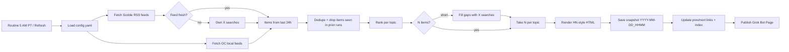

# Daily Pulse: Design Document

Status: **Draft / design only**. Nothing gets built until John says go.

## 1. Goal
A personal news pulse, just for John, in the spirit of Robert Scoble's [News Pulse](https://news-pulse-docs-4g7j.pages.grok.bot/). It's a long list of very short, linked bullets on topics he wants to follow up on. It's published as a **Grok Bot Page** and auto-refreshed daily at **5:00 AM PT** by a Grok Bot routine.

## 2. Look & feel (Hacker News style)
- A dense numbered list with minimal whitespace and small type. Each bullet is one line.
- Bullets are headline-only. **The bullet text is a link to its own source** (X post or article) and opens in a new tab (`target="_blank" rel="noopener"`).
- A small gray source domain follows each headline, e.g. `(x.com)` or `(ocregister.com)`.
- A thin header shows the date, the refresh timestamp, a Refresh button, and ← previous / next → links.
- The footer credits Robert Scoble / Scobleizer for the feeds.

```
Daily Pulse · Mon Nov 2, 2026 · refreshed 5:00 AM PT   [Refresh]  ← prev | index
TOP STORIES
 1. Headline text goes here (x.com)
 2. Another headline (reuters.com)
AI
 1. ...
```

## 3. Topics (defaults, all configurable)
| Order | Topic | Bullets |
|---|---|---|
| 1 | Top Stories | 10 |
| 2 | AI | 10 |
| 3 | Investing & Markets | 10 |
| 4 | General Tech | 10 |
| 5 | Huntington Beach / OC Local | 3 |

Topics, order, per-topic counts, sources, and search terms all live in `config.yaml`. We expect to iterate a lot, so changes shouldn't require code edits.

```yaml
timezone: America/Los_Angeles
schedule: "0 5 * * *"
topics:
  - id: top
    title: Top Stories
    count: 10
    feeds: [https://presto-ferry-g7bz.here.now/feeds/top-20.xml]
    x_search: []
  - id: ai
    title: AI
    count: 10
    feeds: [<scoble ai feed>]
    x_search: ["AI model release", "OpenAI OR Anthropic OR xAI"]
  - id: markets
    title: Investing & Markets
    count: 10
    feeds: [<scoble investor feed>]
  - id: tech
    title: General Tech
    count: 10
    feeds: [<scoble tech feed>]
  - id: hb
    title: Huntington Beach / OC Local
    count: 3
    feeds: [<OC Register>, <Voice of OC>, <City of HB news>]
    use_x: false
```

## 4. Sources
- **Scoble's RSS feeds**: `https://presto-ferry-g7bz.here.now/feeds/top-20.xml`, plus the sibling per-topic feeds, OPML, and `index.json`. Items mostly link to x.com and include a title, summary, "why it matters," and a category.
- **Own X searches** via Grok Bot public X reads (limits: 30 calls/min, 1,000/day, 25 results/call). These fill gaps and serve as the fallback when a feed is stale.
- **Local news** comes from OC news sites (OC Register, Voice of OC, City of Huntington Beach feeds), not from X.

## 5. Pipeline


## 6. Snapshots & history
- Each run writes its own file, named by date and time, e.g. `runs/2026-11-02_0500.html`.
- Each page links ← previous / next →.
- An `index` page lists all runs, newest first.
- `state/seen.json` tracks item URLs from prior runs so they don't repeat.

## 7. Refresh button
The goal is a button on the page that reruns the pulse right away and creates a new timestamped snapshot.
- **Unverified:** whether a Grok Bot Page can trigger a routine/run directly.
- **Fallback:** the button copies a "refresh my pulse" request to paste into chat, or John simply asks in chat.

## 8. Proposed repo layout
```
daily-pulse/
  README.md
  DESIGN.md
  config.yaml          # topics, counts, sources, search terms
  src/
    fetch.py           # RSS + local feeds
    xsearch.py         # X search gap-fill/fallback
    rank.py            # dedupe, seen-filter, ranking
    render.py          # HN-style HTML
    publish.py         # snapshot, prev/next, index, Page publish
  templates/page.html
  runs/                # one snapshot per run
  state/seen.json
```

## 9. Open questions
1. Can a Page button trigger a run? If not, which fallback does John prefer?
2. Exact URLs for Scoble's AI, Tech, and Investor feeds (read from the OPML / index.json).
3. Ranking signal: Scoble's order, engagement, recency, or John's interests?
4. Should summaries / "why it matters" appear on hover, or stay headline-only?
5. Which City of HB feeds are reliable? Should there be any Discord / other local sources?
6. Snapshot retention: keep everything, or prune after N days?
7. Should Page snapshots also be committed to this repo?
